  

  
  
  
  
  

 

Desenho produtos digitais da pesquisa à interface e os construo com IA. Há mais de cinco anos crio experiências para clientes, usuários e equipes, conectando pesquisa com usuários, decisões de produto e os sistemas por trás delas.

Aqui ficam os produtos que eu construo: desenhados e desenvolvidos de ponta a ponta com **Spec-Driven Development**.

## Projetos em destaque

| Projeto | O que é | Stack |
| :-- | :-- | :-- |
| **[Chuvarada](https://github.com/luarawork/chuvarada)** [no ar](https://chuvarada.vercel.app) · código aberto | Mapa de risco de alagamento em tempo real para 28.483 bairros brasileiros, nos 5.570 municípios do país, com dados públicos do INPE, da ANA, da NASA e do IBGE. 89% de acurácia na validação nacional. | Next.js, TypeScript, Supabase, Tailwind, Vitest, GitHub Actions, Vercel |
| **[Felines](https://github.com/luarawork/felines)** Hack the Kitty 2026 | Plataforma que mapeia colônias de gatos em situação de rua e transforma cidadãos comuns em guardiões. Construída sozinha em 14 dias: **27º lugar entre 417**, nota máxima em Segurança e Relevância ao Tema, WCAG 2.2 e versão completa em português e inglês. | Next.js, TypeScript, Tailwind, Supabase, Leaflet, Netlify |
| **[luara.work](https://github.com/luarawork/portfolio)** [no ar](https://luara.work) | Meu portfólio em três línguas. Sem framework e sem etapa de build, acessível (WCAG 2.1 AA) e com dados estruturados para busca. | HTML, CSS, JavaScript |

## Como eu construo

- **Especificação primeiro.** Problema, escopo, decisões de arquitetura e critérios de aceite são escritos antes de qualquer código, para que cada entrega possa ser conferida.
- **A IA constrói, as decisões são minhas.** O Claude Code faz o trabalho pesado; o que construir, para quem e por quê continua sendo decisão de design e de produto.
- **Qualidade é requisito, não etapa.** Testes automatizados e integração contínua, acessibilidade e segurança desde o início: nenhuma chave no código, limite de requisições nas rotas públicas e auditoria antes de publicar.
- **Design e código no mesmo ciclo.** Os estados de carregamento, vazio e erro são desenhados antes, e não descobertos em produção.

## Stack

**Design**: Figma, FigJam, Miro 

**Front-end**: TypeScript, JavaScript, React, Next.js, Tailwind CSS, HTML, CSS 

**Back-end e dados**: Node.js, Supabase (PostgreSQL), Python, SQL 

**Testes, versionamento e deploy**: Vitest, Git, GitHub Actions, Vercel, Netlify 

**IA**: Claude Code, Claude Design, Cursor, Codex, engenharia de prompt, Spec-Driven Development

**Produto e processos**: ServiceNow, Jira, Notion, BPMN

## Escrita

Escrevo sobre UX, produto e desenvolvimento com IA, em português no [Substack](https://substack.com/@luarawork) e em inglês no [Medium](https://medium.com/@luarawork).

 

Desenhado e escrito por mim. O topo é um SVG feito à mão.

